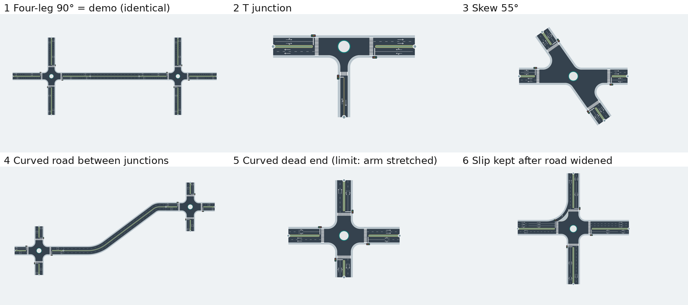

# Spike 1B — Road-first authoring on the existing engine

Date: 2026-10-13 · Roadmap: Phase 1B · Decision: [ADR-0002](../decisions/ADR-0002-road-first-compile.md)

## Question

Can a junction be **derived from crossing roads** while reusing the current edge, curb-return, mouth/datum, pocket and Slip geometry?

## Approach

`core/road-first/derive.ts` (prototype, not wired into the UI):

1. **Roads** own a polyline alignment (optional PI radius) and a section: lanes per direction, lane width, median, sidewalk, bands.
2. `detectCandidates(roads)` finds crossings and tee points. Roads meeting at one point form one candidate. **Nothing changes topology here.**
3. The engineer's **decisions** (`junction` / `grade-separated` / `ignore`) plus junction treatments keyed by **road leg** (`roadId:ahead|behind`) are inputs.
4. `compileRoadNetwork(roads, decisions)` emits an ordinary `NetworkProject`:
   - each confirmed candidate → `JunctionInstance` whose arms are the road legs at that point (heading = road tangent, sorted by heading so "next arm" keeps left-hand-traffic Slip semantics; lanes mapped per travel direction; arm length = straight approach zone);
   - each road between two junctions → `RoadLink` from the ahead-leg port to the behind-leg port; bends between them become PIs with their radius;
   - treatments (Slip lanes, corner radius) are re-bound to arm slots on every compile.

Every existing consumer (junction geometry, Slip overlay, validation, reviews, Network 2D, section dock, 3D, export) runs unchanged on the result.

Run: `pnpm spike:road-first` → evidence in `artifacts/spike-road-first/` (SVG/PNG per case + `results.json`).

## Results against the pass criteria

| Criterion (roadmap 1B) | Result | Evidence |
| --- | --- | --- |
| 90° four-leg | **Pass** — three roads reproduce `createNetworkProject()` exactly: junction `edges()`, port refs and link geometry identical (tolerance 1e-6) | case 1 |
| 3-leg T | **Pass** — 3 active arms, side road 1+1 lanes without median; engine validation clean | case 2 |
| Skew ≥ 40° | **Pass** — 55° crossing, arm headings 0/55/180/235; validation clean | case 3 |
| One curved approach road | **Pass between junctions** — bends become RoadLink PIs (R = 60 m). **Fails as a dead end** — see limit L1 | cases 4, 5 |
| Junction with Slip | **Pass** — Slip keyed to `R1:behind` stays on the same road leg after R1 is widened from 2 to 3 eastbound lanes; Slip invariant (`edges` with/without Slip identical) holds | case 6 |
| Arms are road end portions; section edit updates mouth | **Pass** — widening the road changes the junction edges on recompile | case 6 |
| Candidate is explicit | **Pass** — no decision or "grade separated" creates no junction | case 7 |

All 8 checks pass (`results.json`). Engine checks per case: `designError` = null for every junction, `validateNetworkProject` = null, no port-facing/alignment link issues.

## Limits found (current engine/model, not the road-first idea)

| # | Limit | Effect on road-first | Needed change |
| --- | --- | --- | --- |
| L1 | Network has no **road end** node; RoadLinks only join junction ports | Roads with no confirmed junction, grade-separated crossings, and curved tails beyond the last junction cannot be drawn | **Resolved in Phase 2** — Network schema v5 `roadEnds[]`; road-first compiles curved tails and unjunctioned roads to road-end links |
| L2 | Junction arms are straight and **≥ 45 m** (`valid()`), and must fit stop line + solid divider | Junctions closer than ~90 m along a road, or a bend within 45 m of a junction, are misrepresented (spike stretches the arm to 45 m and reports it) | **Resolved in Phase 2** — arm length is checked against what the arm carries (`core/junction/arm-fit.ts`); a plain four-leg arm needs ~31 m and junctions ~70 m apart compile on the alignment. Continuing the solid divider onto the RoadLink is still open |
| L3 | Junction Design has **4 arm slots** | 5+ legs rejected (reported) | Out of scope for now; record as known limit |
| L4 | Arm marking defaults (solid divider 36 m) assume long arms | Short approach zones fail validation | **Resolved in Phase 2** — the solid divider keeps its configured length and is drawn up to the arm end; a review note reports the shortened length |
| L5 | Junction treatments are stored per arm slot | Re-deriving arms could re-assign pockets/Slip to the wrong leg | Key all arm-level treatments (pockets, markings overrides, roadside, Slip) by road leg; spike shows this for Slip |

## Conclusion

**GO** for road-first as an **authoring layer that compiles to the existing Network/Junction model**. The junction engine does not need to be replaced or forked; the spike reproduced the existing demo exactly and kept Slip semantics through road edits.

Phase 2 must address L1, L2, L4 and L5 before the Draw Road workflow can ship. L3 stays a documented limit.

## Not covered by the spike

- Roundabouts compiled from roads (expected to work through the same arm mapping; untested).
- Pockets and per-arm overrides keyed by leg (same mechanism as Slip; untested).
- Editing a junction's arm geometry directly (in road-first this becomes a road edit — UI design question for Phase 3).
- Performance on large networks (compile is linear in candidates × legs; not measured).
